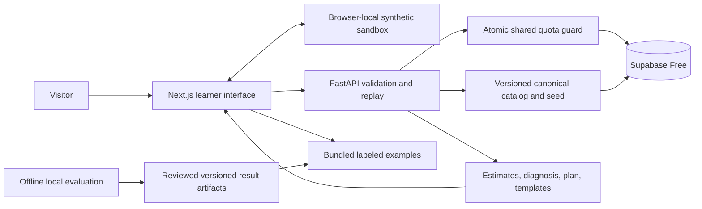

# System design

**Status:** Phase 0 contracts/review and Phase 1 feasibility passed. Full analysis/browser-store behavior below is frozen design for Phase 2/3. **Baseline:** [PROJECT.md](../PROJECT.md), Sections 4, 7, 8, 11, and 12. **Requirements:** [requirement.md](../requirement.md).

This document owns runtime behavior, data flow, consistency, and failure handling. Module layout and technology decisions belong in [architecture.md](architecture.md).

## 1. System boundary



The diagram shows logical components, not separate paid services. Analysis runs inside one lightweight API. Offline research does not run on the request path. No public account, learner database write, LLM call, queue, or code-execution service is needed in P0.

## 2. State placement

| State | Owner | Persistence rule |
| --- | --- | --- |
| Concepts, prerequisite edges, questions, options, grading, seed events | Canonical-data publisher | Immutable published revisions in source/database; public clients cannot edit them. |
| Visitor responses, assessment IDs, pending answer, current local revision | Browser sandbox | Local by profile/version; no verified identity or cross-device guarantee. |
| Analysis result and version/digest | API-derived; browser displays | Recomputed from canonical seed plus visitor prefix; optionally cached locally only with matching digest. |
| Shared request budgets | API guard/Postgres | Atomic counters; expire within 48 hours; no raw client identifiers. |
| Runtime object/cache | API instance | Disposable optimization; bounded and version-keyed, never a durable authority. |
| Evaluation and prerecorded results | Offline evaluator | Reviewed compact artifacts identifying input/configuration versions. |

The browser is allowed to alter its own synthetic scenario. Server grading prevents accidental/forged client scores from becoming authoritative, but does not make a browser-controlled history a verified student record.

## 3. Profile initialization

1. Future client fetches the active analysis-release pointer, then pins release-scoped profile/seed reads; legacy preview routes retain their Phase 1 shapes.
2. Fetch the selected immutable seed and public curriculum/catalog projection.
3. Select the IndexedDB record keyed by profile, full release/hash/seed/graph/catalog/model tuple and contract version; see the exact ordered key in browser_storage.md.
4. If versions match, restore acknowledged visitor events; otherwise offer explicit reset/migration guidance.
5. Validate and analyze the restored prefix before presenting it as a fresh live result. A cached result may be shown with a saved-state label while validation is pending.
6. Keep future answer options visible as needed, but omit grading keys from ordinary API responses until feedback is due.

Public repository source can reveal authored grading rules; the product is not a secure exam platform.

## 4. Submission and consistency

```mermaid
sequenceDiagram
    participant B as Browser sandbox
    participant A as FastAPI
    participant D as Postgres
    B->>B: Commit event, focus/trigger snapshot and pending revision in IndexedDB
    B->>A: Version envelope + bounded full visitor history
    A->>A: Reject oversized/invalid envelope
    A->>D: Atomically reserve request quota
    D-->>A: Allowed / exhausted / unavailable
    A->>D: Load matching published canonical inputs
    A->>A: Deduplicate, validate ordering, grade and replay
    A->>A: Estimate, diagnose/abstain, plan, explain
    A-->>B: One bundle + semantic digest + versions
    B->>B: Accept only current local revision; acknowledge once
```

Large bodies should be rejected before full parsing/expensive work; the quota guard must run before expensive replay/canonical lookups. Count validly admitted analysis attempts against quota even if deeper event validation fails; retries also consume requests. Do not refund counters in a way that permits bypass.

The frozen lg-c14n-v1 digest covers versions, profile/focus/trigger selector, and normalized/deduplicated events; receipt/request IDs and sandbox/revision transport fields are excluded. UTC milliseconds, null metadata and safe-integer bounds are defined in [protocol](../contracts/protocol.md) and checked by Python/Node vectors. Same semantic input yields the same analysis; scoring/grading changes require explicit versions.

P0 atomicity is **all-or-nothing analysis response**, not a fictional transaction persisting visitor history. There is no visitor write. When owned persistence is added later, define unique event constraints, real transactions/recomputation, and concurrent-write handling separately.

## 5. Evidence and analysis

1. Load server-owned seed history; reject a client attempt to replace it.
2. Deduplicate identical visitor event IDs; reject conflicting content with `409`.
3. Validate contiguous visitor sequence starting at 1, nondecreasing occurrence times after seed history, known options/activities, and published versions. Invalid ordering/schema returns `422`.
4. Derive grades and metadata; never accept authoritative client correctness/tags.
5. Determine eligible first responses to distinct primary-concept questions with known zero hints.
6. Compute the smoothed estimate and evidence state from PROJECT Section 8.3. Unknown concepts remain unknown in UI.
7. For a failed target, consider the target and prerequisites within three edges; apply evidence gates before ranking. Unknown/early prerequisite evidence requests remain distinct from ranked weaknesses.
8. Build a maximum-five-item plan with valid catalog IDs and readiness locks. Missing fresh content returns explicit exhaustion, not fabricated activities.
9. Render templates from actual evidence and return the single bundle.

Retrospective diagnosis may use the just-observed failure. Offline next-response prediction must use only the preceding prefix. A lesson or hinted retry does not add baseline evidence; reassessment uses another item.

## 6. API surface

| Route | Success behavior | Important failures |
| --- | --- | --- |
| `GET /health` | Lightweight process liveness. | Must not claim database readiness. |
| `GET /ready` | Bounded dependency readiness; no sensitive details. | `503` if required database/quota access fails. |
| `GET /api/v1/demo/release` | Future active analysis-release pointer. | `503` when not configured/published. |
| `GET /api/v1/releases/{release_id}/profiles` | Future release-scoped summaries and full version references. | Unsupported versions `409`; controlled dependency failure. |
| `GET /api/v1/releases/{release_id}/profiles/{id}/seed` | Future pinned seed/catalog/graph projection. | Unknown profile `404`; no unanswered feedback exposure. |
| `POST /api/v1/demo/analyze` | Versioned history/grade/estimate/diagnosis/plan bundle. | `409` conflict/version mismatch, `413` byte limit, `422` invalid events, `429` quota, `503` unavailable dependency. |
| `GET /api/v1/analytics/evaluation` | Published measured summary only when an artifact exists. | Explicit unavailable/not-published state before evaluation exists. |

Exact DTOs, generated JSON Schema, data dictionary and safe errors are frozen in [contracts](../contracts/protocol.md). Future FastAPI OpenAPI must reuse these models rather than invent another shape. The new routes are not implemented. Existing /api/v1/demo/profiles, its /{id}/seed and bootstrap/answer keep their deployed legacy contracts. Zero automatic POST retries; explicit retries preserve the same pending snapshot and honor 429 guidance.

## 7. Browser concurrency and local reset

- [browser_storage.md](browser_storage.md) owns the frozen IndexedDB transaction/revision state machine and fourteen required browser scenarios.
- Stage pending event plus focus/trigger/revision, commit, then send outside the transaction. After refresh reconstruct the same request; never replace it with current UI selectors.
- Acknowledge once only when versions, profile/focus, sandbox UUID, revision, pending ID and recomputed digest match. Cached bundles must describe the acknowledged prefix.
- Compare-and-swap in one readwrite transaction resolves same-browser tab conflicts. BroadcastChannel is advisory; no-channel fallback still checks authoritative storage before mutations.
- Reset changes the sandbox UUID and clears only local visitor work. Failed storage commit offers explicit per-tab session mode before any answer is sent. No automatic version migration or false live acceptance.

## 8. Failure and recovery behavior

| Condition | Required behavior |
| --- | --- |
| Database paused or quota guard unavailable | `503`, preserve pending history, disable live acceptance, offer labeled bundled examples. |
| Request budget exhausted | `429` and retry guidance; no paid fallback or quota bypass. |
| Cold start/network timeout | Bounded retry with identical IDs; no duplicate evidence or false success. |
| Catalog/graph/model change | Explicit version conflict and reset/migration; never silently rescore old responses. |
| No evidence or no supported gap | Valid result with abstention/evidence request, not a server error. |
| No suitable unseen questions | Valid exhausted/no-suitable-item state with optional labeled review. |
| LLM absent | No effect on P0; templates are the implementation. |

## 9. Frozen Phase 0 decisions

- [Protocol/schema/manifest](../contracts/protocol.md): strict envelopes, exact version/hash identity, 300-second future skew, safe errors, release-scoped rollout, and retained legacy routes.
- [Curriculum review](../curriculum/review.md): scoped 12-node/17-edge DAG, independent bottom-up DP route, revised 12-question/2-lesson slice and four synthetic seed definitions.
- [Policy configuration](../curriculum/model-config.v1.json): first-response evidence, explicit uncertainty, rational ranking/ties, measured readiness, distinct reassessment, and honest exhaustion.
- [Browser storage](browser_storage.md): transactional pending/acknowledged history, stable keys, reset/new UUID, refresh recovery and cross-tab conflict handling.
- [Evaluation definition](../evaluation/readme.md): 4 training/8 development/12 public audit cases with separate annotations; six additional blueprint scenarios. No blind-test/generalization or measured benchmark claim.

Phase 1's NOLOGIN runtime group, shared atomic fixed-minute/daily guard, HMAC client signals and bounded cleanup remain verified. These definitions require no extra infrastructure. Phase 2 implements the pure analysis services and publication path; Phase 3 implements/tests the browser store.


## 10. Implemented Phase 1 subset — 20 November 2026

The current API implements `/health`, `/ready`, profile/seed reads, and `POST /api/v1/bootstrap/answer`. The bootstrap route validates a response against database-owned question options, reserves the shared budget, grades the answer, and returns `persisted: false`. It is a feasibility endpoint, not the planned full-history `/api/v1/demo/analyze` contract. Complete replay, input digests, estimates, diagnosis, plans, local progress, and reassessment flow remain Phase 2/3 work.

The source contains one synthetic profile and 12 authored questions across two concepts, plus the proposed 12-node/17-edge graph. It does not claim all four profiles or the complete 72-question curriculum exist.

Verified hosted boundary: public browser → FastAPI → TLS transaction-pooled Supabase → canonical question and atomic quota guard → real grading feedback. `/ready` returns 200; the browser displayed the correct server explanation after selecting `n`. Runtime canonical/quota writes and public-role access are denied; even the owner cannot update a published release. The initial unconfigured-dependency failure was also exercised before provisioning. Evidence is in [deployment](deployment.md) and [performance review](performance_review.md).
