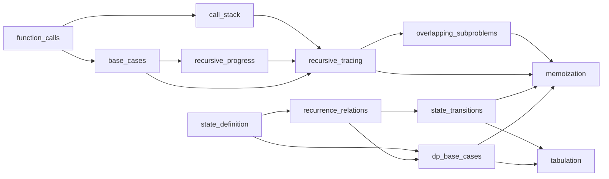

# Curriculum review — 20 November 2026

**Result:** engineering review complete for twelve concepts, seventeen scoped edges, a twelve-question/two-lesson slice, and four draft synthetic profiles. This is not educator validation, calibrated difficulty, a completed 72-question catalog, or a new deployed release. Original project content has no selected public license; no external question bank was copied.

## Concept and edge decisions

[graph.v1.json](graph.v1.json) stores definitions, entry assumptions, navigation groups, edge types, rationales, source, and review status. Arrows mean prerequisite→dependent. Diagnosis reverses those edges; plans follow them forward. Topic membership never adds prerequisites. Basic Python syntax/variables/conditionals/loops/list indexing/integer arithmetic are unassessed entry assumptions; missing evidence for assessed function calls remains unknown.

The legacy graph indirectly made bottom-up DP require recursive tracing and recursive base cases. The reviewed track removes four edges: recursive_tracing→recurrence_relations, recurrence_relations→state_definition, state_definition→state_transitions, base_cases→dp_base_cases. It adds state_definition→recurrence_relations, recurrence_relations→state_transitions, recurrence_relations→dp_base_cases, recursive_tracing→memoization.

The DP route now begins at state definition and reaches tabulation without any recursion ancestor. Top-down memoization still requires tracing plus repeated-subproblem recognition and a valid recurrence/boundary formulation. Recursive tracing→overlapping_subproblems is scoped to this track's recursive-call-tree presentation, not a universal claim about overlap. These instructional dependencies are hypotheses for this curriculum, not causal diagnoses.

The two roots are function_calls and state_definition. All twelve IDs remain stable; no node is deleted. Graph validation rejects duplicate IDs/edges, unknown endpoints, self edges and cycles, and explicitly checks the independent tabulation route.

## Item-by-item review

All reviewed questions use activity version 2 in catalog-slice-v1, because foundational/context metadata and several prompts changed. The published Phase 1 activity versions remain 1. Correct option keys below were checked by reading the authored examples, not by a learner-code execution service.

| Activity | Primary skill / reviewed answer | Decision |
| --- | --- | --- |
| function_calls_diagnostic_01 | Argument→return, b=6 | Retain; basic direct call, foundational. |
| function_calls_practice_01 | Return versus output, c=5 | Retain; absence of print does not remove the return value. |
| function_calls_practice_02 | Composition, d=8 | Retain; follow two returned values, no recursive stack required. |
| function_calls_practice_03 | Output ordering, a=A then 7 | Retain; function-side print precedes caller print. |
| function_calls_practice_04 | Implicit return, b=None | Retain as Python function semantics, not a language-independent claim. |
| function_calls_reassessment_01 | Positional arguments, c=−5 | Replace the near-clone nested-call item with reversed argument positions and subtraction; same primary skill, independent problem. |
| base_cases_diagnostic_01 | Empty prefix, a=n==0 | State the nonnegative integer domain and sum definition explicitly. |
| base_cases_practice_01 | Stopping branch, c=0 | Replace count(3) tracing with the boundary at n=0; removes an unassessed tracing requirement. |
| base_cases_practice_02 | Factorial boundary, b=1 | State nonnegative domain and 0! definition; measure branch selection, not recall of an unstated convention. |
| base_cases_practice_03 | Two boundaries, c=n | Supply fib(0)=0/fib(1)=1 and domain explicitly. |
| base_cases_practice_04 | Empty list, d=len(items)==0 | Explain list-tail notation and list input type. |
| base_cases_reassessment_01 | Power boundary, c=1 | State nonzero base/nonnegative exponent, avoiding the 0^0 convention ambiguity. |

Each question has one primary concept; base-case questions tag function_calls as context only. Function-call items are foundational; base-case remediation requires measured function-call readiness. Every item has four unique options, one key, an explanation, ordinal difficulty, active/role/version fields and original-content provenance. Two short lessons support the slice and add zero evidence. No review here calibrates difficulty or establishes robust measurement from six items per concept.

## Four draft archetypes

[profiles.v1.json](profiles.v1.json) contains explicit UUIDs, ordered UTC timestamps, activity versions, run IDs and hints. They are public demo examples, excluded from benchmark learners.

| Profile | Seed evidence | Intended behavior |
| --- | --- | --- |
| Mira / target_gap | Function calls 3/3; base cases 0/3 | Inspect target weakness with secure prerequisite evidence. |
| Arjun / upstream_gap | Function calls 0/3; base cases 2/3 | Inspect supported function-call weakness without automatically blaming the mixed target or claiming causality. |
| Leena / sparse | Function calls 1/1; base cases unassessed | Gather evidence; no supported weakness claim. |
| Kabir / ambiguous | Function calls 3/3; base cases 2/3 | Developing target evidence after a failure; abstain from a supported gap. |

## Fresh-item loop and its limit

Mira has two unused base-case practice questions and a separate unused reassessment. Function calls is ready at 5/7. Starting from 0/3 base-case successes, two correct fresh practices produce 3/8 then 4/9; a correct distinct reassessment produces 5/10. That becomes developing evidence, **not** readiness at 0.65. This is a feasible question→practice→different-reassessment trace, not proof of learning or guaranteed readiness. Incorrect/hinted results must remain visible and can leave the skill weak/exhausted.

Arjun can exhaust all six function-call items while still below readiness; the system must return a blocked/exhausted path rather than unlock base-case practice or count retries as fresh observations. The separate [Phase 4 full review](full-review.md) now covers the remaining sixty questions and broader lessons; this document retains the frozen slice review. More items alone do not guarantee threshold crossing. [Protocol](../contracts/protocol.md) defines readiness/exhaustion; [PROJECT §8](../PROJECT.md) retains formula ownership.

The active [phase1.json](../backend/data/phase1.json) is deliberately unchanged, including its old graph. The draft must be published under a new compatible release after Phase 2 supports its schema. CI checks legacy content integrity and the reviewed draft independently.
